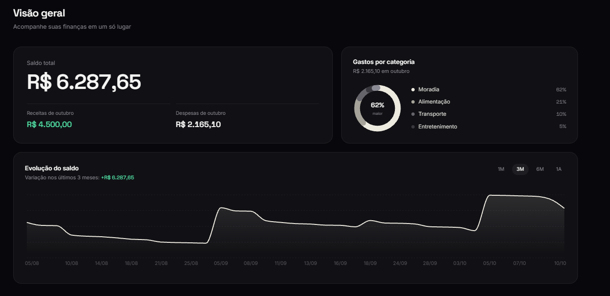
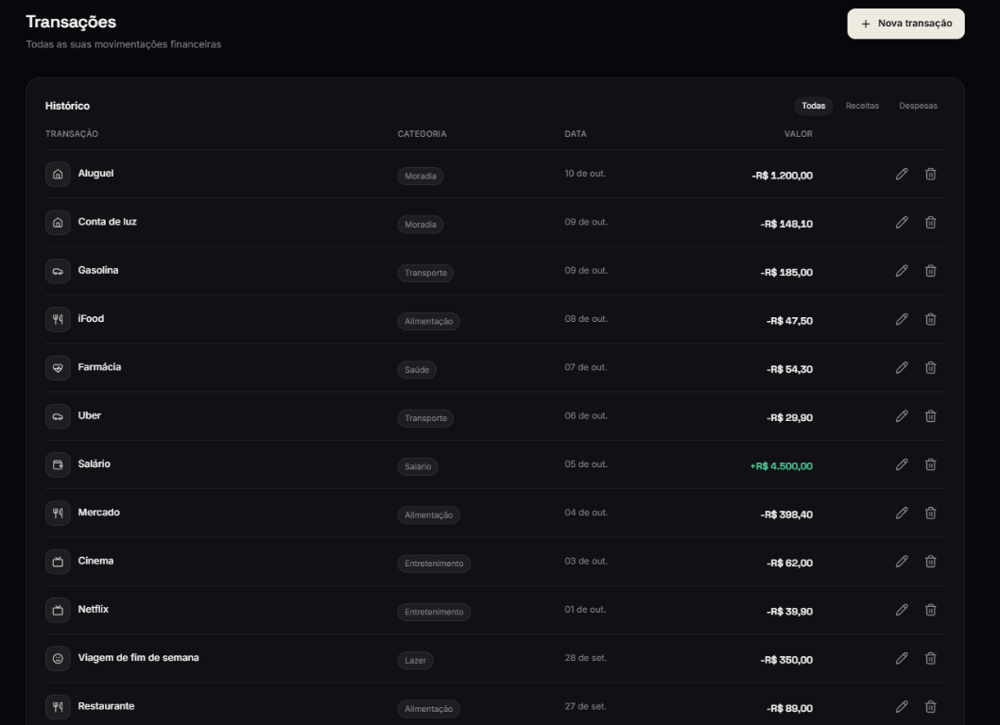
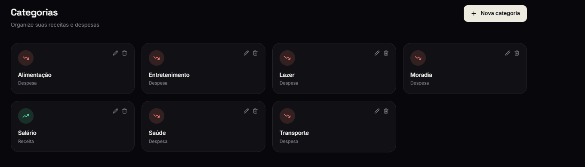
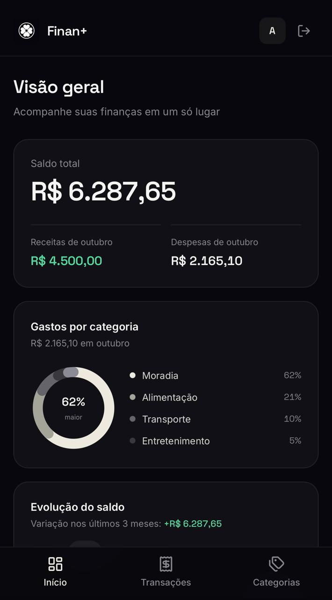

# Finan+


Aplicação web full stack de controle financeiro pessoal. Registre receitas e despesas, organize por categorias e acompanhe a evolução do saldo em um painel visual.

**Acesse:** https://meufinanmais.vercel.app

> **Como testar:** crie uma conta em "Cadastre-se". Ela já nasce com as categorias padrão (Salário, Alimentação, Transporte, Moradia, Saúde, Entretenimento e Lazer).
>
> O backend roda em um plano gratuito, então a primeira visita depois de um período sem uso pode demorar um pouco para responder.

## Funcionalidades

- Cadastro e login com autenticação JWT e senhas protegidas com hash (bcrypt)
- Categorias padrão criadas automaticamente no cadastro de cada usuário
- CRUD de transações e de categorias, com avisos na tela de sucesso e de erro
- Sugestão automática de categoria a partir da descrição digitada (ex.: "Uber" sugere Transporte), sem sobrescrever a escolha manual
- Dashboard com saldo total, receitas e despesas do mês, gastos por categoria e gráfico de evolução do saldo com filtro de período (1M, 3M, 6M e 1A)
- Lançamento rápido em uma linha (ex.: "uber 25,90 ontem"): o app entende valor, data e categoria e mostra uma prévia antes de salvar
- Importação de extrato bancário em OFX ou CSV, com prévia, categorização automática, detecção de lançamentos possivelmente duplicados e importação em lote
- Filtro de transações por receitas e despesas
- Valores em reais e datas tratadas como dias de calendário, sem diferença de fuso
- Layout responsivo: barra lateral no computador e barra de navegação inferior no celular
- Instalável na tela de início do celular e do tablet, com nome e ícone próprios (testado no iPad)
- Tratamento de sessão expirada: o app encerra a sessão e leva o usuário de volta ao login
- Proteção contra envio repetido enquanto o salvamento está em andamento

## Telas







### No celular

O app é responsivo e pode ser instalado na tela de início.



## Tecnologias

**Frontend:** React, Vite, Tailwind CSS v4, React Router, Axios, Recharts, Lucide React

**Backend:** Node.js, Express, Prisma ORM v7 (driver adapter `pg`), JWT (jsonwebtoken), bcryptjs, helmet e express-rate-limit

**Banco de dados:** PostgreSQL (Neon)

**Deploy:** Vercel (frontend) e Render (backend)

## Arquitetura

```
controle-financeiro/
├── backend/    API REST (Express + Prisma)
└── frontend/   Aplicação React (Vite)
```

O frontend consome a API REST do backend. A autenticação usa token JWT enviado no cabeçalho `Authorization`. Para requisições com cabeçalho `Origin`, o CORS permite o domínio do frontend em produção, o localhost em desenvolvimento e uma origem adicional opcional definida por `LOCAL_ORIGIN`.

## Decisões técnicas

- **Autenticação própria:** JWT implementado manualmente, para entender o fluxo completo de registro, login e rotas protegidas.
- **Cadastro atômico:** o usuário e as categorias padrão são criados na mesma transação do banco, então ou os dois existem ou nenhum.
- **Sugestão de categoria local:** correspondência por palavras-chave, sem chamada externa, para resposta instantânea e custo zero.
- **Leitura do extrato no navegador:** o arquivo é interpretado no frontend (OFX e CSV, com detecção de separador, colunas de débito/crédito e codificação UTF-8 ou Windows-1252), então nada sai do computador do usuário antes da confirmação na prévia.
- **Importação tudo ou nada:** o backend valida o lote inteiro (até 500 lançamentos) e confere se todas as categorias pertencem ao usuário antes de gravar; se uma linha for inválida, nada é salvo.
- **Datas como dia de calendário:** as datas são gravadas e exibidas em UTC, para uma transação de 11 de outubro continuar aparecendo como 11 de outubro em qualquer fuso.
- **Banco serverless:** Neon, que religa sozinho após inatividade, sem restauração manual. A troca veio depois de o plano gratuito do provedor anterior pausar o banco por inatividade.
- **Backend gratuito:** a rota leve (`/ping`) está disponível para receber chamadas periódicas de um serviço externo e evitar que o servidor "durma", sem consultar o banco.

## Segurança

- Senhas com hash (bcrypt); o login compara o hash mesmo quando o e-mail não existe, para dificultar descobrir quais e-mails têm conta
- Campos de autenticação, transações e categorias validados no servidor, independentemente do formulário usado
- Cada usuário acessa apenas os próprios dados, inclusive ao vincular transações a categorias
- Limite de requisições por IP e limite de tentativas de login e cadastro
- A importação de extrato é a única rota com corpo maior (150 KB), com limite próprio de 10 importações por IP a cada 15 minutos
- Cabeçalhos de segurança (`helmet`), limite de 10 KB no corpo das demais requisições e CORS configurado para o domínio de produção, o localhost e uma origem adicional opcional
- Variáveis sensíveis fora do repositório

## Limitações e próximos passos

- O token fica no `localStorage` e não pode ser revogado antes de vencer (7 dias); uma melhoria seria cookie `httpOnly`
- Não há recuperação de senha
- Os testes automatizados cobrem as validações e a importação no backend (com o banco simulado) e os leitores de texto do frontend (lançamento rápido e extratos); ainda não cobrem as rotas contra um banco real nem os componentes de tela
- A importação foi testada com amostras nos formatos mais comuns (OFX, CSV de conta e de fatura de cartão, CSV com débito/crédito); cada banco tem suas particularidades e alguns formatos podem precisar de ajuste
- Próximos passos: detecção de assinaturas e gastos recorrentes, metas por categoria e resumos prontos

## Como rodar localmente

Pré-requisitos: Node.js e um banco PostgreSQL (por exemplo, um projeto gratuito no Neon).

### Backend

```bash
cd backend
npm install
```

Copie `backend/.env.example` para `backend/.env` e substitua os valores de exemplo por suas configurações locais. Gere um `JWT_SECRET` aleatório com pelo menos 32 caracteres; não use o valor de exemplo.

```bash
npx prisma generate
npx prisma migrate deploy
node src/server.js
```

A API sobe em `http://localhost:3000`.

### Frontend

```bash
cd frontend
npm install
```

Copie `frontend/.env.example` para `frontend/.env`. Ajuste `VITE_API_URL` se a API local estiver em outro endereço.

```bash
npm run dev
```

O app abre em `http://localhost:5173`.

## Autor

Francisco Aciole dos Santos Júnior

- GitHub: [franciscoaciole](https://github.com/franciscoaciole)
- LinkedIn: [franciscoaciole](https://www.linkedin.com/in/franciscoaciole-/)
